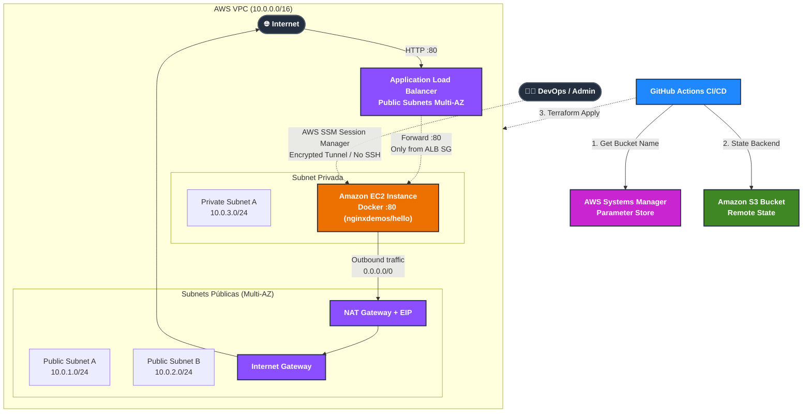

# AWS Multi-AZ Secure Infrastructure with Terraform & GitHub Actions

[](https://github.com/feversani-labs/my-aws-ec2/actions/workflows/terraform.yml)

Este proyecto implementa una infraestructura automatizada, segura y de alta disponibilidad en **AWS** utilizando **Terraform (IaC)** y un pipeline de CI/CD con **GitHub Actions**.

La arquitectura despliega una aplicación web contenarizada en **Docker** sobre una instancia **EC2 en una subnet privada**, accesible al público únicamente a través de un **Application Load Balancer (ALB) Multi-AZ**, y administrable de forma segura mediante **AWS Systems Manager (SSM)** sin exponer el puerto 22 (SSH).

---

## 🔗 Ecosistema e Integración: Ephemeral AWS Sandbox

Este repositorio forma parte de una solución modular para **cuentas efímeras y entornos de sandbox** (como **KodeKloud AWS Playgrounds**), trabajando en conjunto con [**feversani-labs/ephemeral-aws-sandbox**](https://github.com/feversani-labs/ephemeral-aws-sandbox):

1. **Bootstrap del Backend S3:** En el repositorio base se aprovisiona el bucket de estado de Terraform y se guarda su nombre automáticamente en **AWS Systems Manager Parameter Store** (`/ephemeral-aws-sandbox/tfstate/bucket_name`).
2. **Descubrimiento Dinámico del Estado:** En cada ejecución de GitHub Actions, el pipeline consulta el Parameter Store mediante la AWS CLI y configura el backend de `terraform init` dinámicamente (`-backend-config="bucket=$BUCKET"`), eliminando la necesidad de hardcodear buckets en el código.
3. **Estrategia de Credenciales (PoC vs Producción):** En este escenario de sandbox efímero provisto por KodeKloud (donde la cuenta vive pocas horas y entrega un usuario IAM), se emplean `AWS_ACCESS_KEY_ID` y `AWS_SECRET_ACCESS_KEY` mediante GitHub Secrets. Como evolución arquitectónica para cuentas permanentes, el diseño contempla la transición hacia **GitHub OIDC (OpenID Connect)** para asumir IAM Roles sin secretos estáticos.

---

## 🏛️ Diagrama de Arquitectura



---

## 🔒 Decisiones de Seguridad y Buenas Prácticas

| Característica | Justificación y Ventaja |
| :--- | :--- |
| **Aislamiento en Subnet Privada** | La instancia de cómputo no tiene dirección IP pública y no es alcanzable directamente desde internet. |
| **Zero-SSH / SSM Session Manager** | No se abren puertos de administración (22) ni se gestionan llaves `.pem`. La conexión se realiza autenticada mediante IAM y auditada por CloudTrail. |
| **Defensa en Capas (Security Groups)** | El Security Group de la EC2 solo permite tráfico entrante por el puerto 80 si proviene del Security Group del ALB. |
| **Alta Disponibilidad (Multi-AZ)** | El Application Load Balancer se distribuye entre 2 Zonas de Disponibilidad (AZs) para cumplir con el estándar de AWS. |
| **Salida Segura (NAT Gateway)** | Permite que la EC2 privada descargue actualizaciones de SO y paquetes Docker sin exponer puertos de entrada. |
| **Backend Remoto Dinámico** | El estado de Terraform (`terraform.tfstate`) se almacena en Amazon S3, resolviendo el nombre del bucket en tiempo de ejecución a través de AWS SSM Parameter Store. |

---

## 📂 Estructura del Repositorio

```text
.
├── .github/
│   └── workflows/
│       ├── terraform.yml       # Pipeline automatizado de Deploy (push a main / dispatch)
│       └── destroy.yml         # Pipeline manual para dar de baja la infraestructura
├── scripts/
│   └── user_data.sh            # Script de inicialización: instala Docker y levanta el contenedor
├── terraform/
│   ├── alb.tf                  # Application Load Balancer, Listener y Target Group
│   ├── data.tf                 # Data sources: AMIs oficiales de Amazon Linux 2 y AZs disponibles
│   ├── ec2.tf                  # Instancia EC2 privada con perfil IAM de SSM
│   ├── iam.tf                  # Rol IAM y políticas para AWS SSM Session Manager
│   ├── networking.tf           # VPC, Subnets (públicas y privadas), IGW, NAT GW y Route Tables
│   ├── output.tf               # Outputs: URL pública del ALB e IDs de recursos
│   ├── provider.tf             # Configuración del proveedor de AWS y backend S3
│   ├── security-group.tf       # Reglas de firewall para ALB y EC2
│   ├── terraform.tfvars        # Parámetros de configuración del proyecto
│   └── variables.tf            # Definición de variables de entrada
└── README.md                   # Documentación técnica del proyecto
```

---

## 🚀 Despliegue y CI/CD

El proyecto utiliza **GitHub Actions** con credenciales de AWS inyectadas de forma segura.

### Requisitos Previos

Configurar en GitHub (**Settings > Secrets and variables > Actions**):

#### Secrets
* `AWS_ACCESS_KEY_ID`: Credencial de acceso a AWS.
* `AWS_SECRET_ACCESS_KEY`: Llave secreta de acceso a AWS.
* `AWS_SESSION_TOKEN`: *(Opcional)* Requerido si se utilizan credenciales temporales (STS / Sandboxes).

#### Variables
* `REGION`: Región de AWS a desplegar (ej. `us-east-1`).
* `TF_VERSION`: Versión de Terraform deseada (ej. `1.7.0` o `latest`).

---

### Flujo de Trabajo (Workflows)

1. **Deploy Automático (`terraform.yml`)**:
   - Se activa ante cada `push` en la rama `main` o manualmente vía `workflow_dispatch`.
   - Consulta dinámicamente el bucket de estado desde AWS SSM Parameter Store.
   - Ejecuta `terraform init` y `terraform apply -auto-approve`.
   - Devuelve la URL pública del ALB en los outputs de la consola.

2. **Destrucción Manual (`destroy.yml`)**:
   - Permite dar de baja toda la infraestructura con un solo clic para evitar costos innecesarios cuando no se está utilizando el entorno.

---

## 🧪 Verificación y Pruebas

### 1. Acceso a la Aplicación Web
Una vez completado el pipeline, abre en tu navegador la URL que figura en el output `alb_dns_name`:
```text
http://<ALB_DNS_NAME>
```
Verás la página de bienvenida de **NGINX Hello World** reportando el hostname interno y la IP privada de la máquina.

### 2. Conexión segura por AWS SSM
Para acceder a la terminal de la máquina privada sin llaves SSH:

```bash
# Iniciar sesión de terminal en la EC2 privada
aws ssm start-session --target <INSTANCE_ID>

# (Opcional) Túnel local de puertos para desarrollo
aws ssm start-session \
  --target <INSTANCE_ID> \
  --document-name AWS-StartPortForwardingSession \
  --parameters '{"portNumber":["80"],"localPortNumber":["8080"]}'
```

---

## 🛠️ Tecnologías Utilizadas

* **Cloud Provider:** Amazon Web Services (AWS)
* **Infrastructure as Code:** HashiCorp Terraform
* **CI/CD:** GitHub Actions
* **Containers:** Docker
* **Operating System:** Amazon Linux 2 (HVM)
* **Security & Remote Management:** AWS Systems Manager (SSM)
